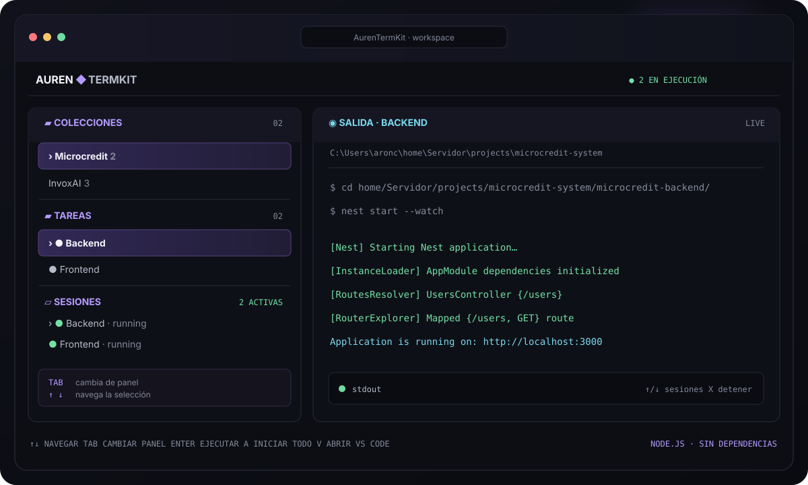

<div align="center">

# AurenTermKit

### Tu entorno de desarrollo, listo desde una sola terminal.

Guarda comandos por proyecto, inicia tu stack con una tecla y sigue todos los logs en una TUI clara. Sin navegador. Sin ventanas de terminal duplicadas. Sin dependencias npm de terceros.


[](https://github.com/JhonattanAron/Auren_Terminal/stargazers)

[View README in English](README.md)

<br>



<br>

[Inicio rápido](#-inicio-rápido) · [Controles](#-controles) · [Tareas](#-crear-una-tarea) · [Configuración](#-configuración) · [Idiomas](#-idiomas)

</div>

---

## ¿Qué es?

AurenTermKit es un administrador de flujos de desarrollo para la terminal. Agrupa proyectos en **colecciones**, guarda sus **tareas** y ejecuta cada comando en orden dentro de una sesión integrada.

Úsalo para iniciar frontend y backend, levantar servicios locales o repetir cualquier secuencia de comandos que suelas escribir a mano.

### Hecho para el flujo real de desarrollo

- **Una tecla para arrancar:** ejecuta una tarea o todas las tareas de una colección.
- **Logs donde los necesitas:** observa la salida de cada proceso dentro del panel lateral.
- **Sesiones bajo control:** detén una tarea individual o cierra AurenTermKit para terminar también sus procesos hijos.
- **Terminal primero:** navega con el teclado; nunca tienes que cambiar a una página web.
- **Comandos editables:** conserva los comandos guardados o reemplázalos desde la misma interfaz.
- **Comodidad de shell:** autocompletado local para rutas y scripts npm, historial de líneas y acceso rápido a VS Code.
- **Configuración local:** tus colecciones, carpetas y comandos se quedan en tu equipo.

## ✨ Inicio rápido

### Requisitos

- Node.js 18 o posterior.
- PowerShell o CMD en Windows; una terminal interactiva en macOS/Linux.
- Opcional: el comando `code` de Visual Studio Code en `PATH` para abrir las carpetas desde AurenTermKit.

### Ejecutar

**Instala AurenTermKit desde npm:**

```bash
npm i -g auren-termkit
aurentermkit
```

`npm i -g auren-termkit` instala el CLI globalmente. Después, ejecuta `aurentermkit` desde cualquier terminal para abrirlo.

**Ejecutar desde el repositorio:**

```bash
git clone https://github.com/JhonattanAron/Auren_Terminal.git
cd Auren_Terminal
npm start
```

No hace falta ejecutar `npm install` para el modo repositorio: AurenTermKit usa módulos incluidos en Node.js.

En el primer inicio aparece una configuración vacía. Crea una colección con `N`, entra con `Enter`, crea una tarea con `N` y guarda tus comandos.

## ⌨️ Controles

`Tab` cambia el panel activo. `↑` y `↓` mueven la selección dentro del panel resaltado. La ayuda al pie de la TUI también cambia según el panel.

<details open>
<summary><strong>Colecciones</strong></summary>

- `↑` / `↓` — elegir colección.
- `←` / `→` — cambiar colección.
- `Enter` — abrir la colección y enfocar sus tareas.
- `A` — iniciar todas las tareas de esta colección.
- `N` — crear colección.
- `E` — cambiar su nombre.
- `D` — eliminarla, con confirmación.

</details>

<details>
<summary><strong>Tareas</strong></summary>

- `↑` / `↓` — elegir tarea.
- `Enter` — ejecutar la tarea seleccionada.
- `A` — iniciar todas las tareas de la colección.
- `V` — abrir en VS Code la carpeta donde termina trabajando la tarea.
- `N` — guardar una tarea nueva.
- `E` — editar nombre, descripción o comandos.
- `D` — eliminar la tarea, con confirmación.

</details>

<details>
<summary><strong>Terminales y salida</strong></summary>

- `↑` / `↓` — elegir una sesión; sus logs aparecen en el panel derecho.
- `X` — detener la sesión seleccionada y sus procesos hijos.
- `C` — limpiar sesiones terminadas.
- `Ctrl+C` dos veces en 2.5 segundos — cerrar AurenTermKit y terminar todas las sesiones.

</details>

En cualquier prompt escribe `exit` para cancelar y volver a la interfaz. `Q` y `Esc` no cierran la aplicación.

## 🧩 Crear una tarea

1. En **Colecciones**, pulsa `N` y escribe un nombre, por ejemplo `Microcredit`.
2. Pulsa `Enter` para abrirla; en **Tareas**, pulsa `N`.
3. Escribe un nombre, por ejemplo `Backend`.
4. Escribe cada comando en una línea. Pulsa `Enter` en una línea vacía o escribe `save` y pulsa `Enter`.

Ejemplo:

```text
cd home/Servidor/projects/microcredit-system/microcredit-backend/
nest start --watch
save
```

Los comandos corren en orden dentro del mismo proceso. La carpeta inicial predeterminada es `C:\Users\<usuario>` en Windows y el directorio home en macOS/Linux. Un `cd` cambia la carpeta de trabajo de los comandos siguientes.

`Tab` completa rutas y scripts npm usando lógica propia de Node.js; no depende de PowerShell ni de la política de ejecución de Windows. `↑` / `↓` recorren el historial en el editor.

Al editar una tarea, responde `N` a “¿Reemplazar los comandos actuales?” para conservarlos. También puedes responder `S` y escribir `save` sin agregar líneas: AurenTermKit mantiene los comandos anteriores y guarda los demás cambios.

## 🖥️ Una sola TUI para todo el stack

Las sesiones se ejecutan en segundo plano y escriben su salida en el panel **Logs**. En Windows se usa `cmd.exe`, así las herramientas de npm encuentran sus ejecutables `.cmd` sin depender de scripts PowerShell. En macOS/Linux se usa `$SHELL` o Bash como alternativa.

Al cerrar AurenTermKit, el gestor termina el árbol completo de cada tarea (`taskkill /T` en Windows y el grupo de procesos en macOS/Linux) para que no queden servidores de desarrollo olvidados.

## 🧭 Abrir una tarea en VS Code

Selecciona la tarea y pulsa `V`. AurenTermKit sigue sus comandos `cd`, determina la carpeta final y abre `code .` ahí. Debes tener instalado el comando `code` de VS Code en `PATH`.

## ⚙️ Configuración

La configuración activa se crea automáticamente y **no se sube a Git**: puede contener rutas, nombres de proyectos y comandos privados.

- Instalación global: `~/.aurentermkit/collections.json` (en Windows, bajo tu carpeta de usuario).
- Ejecución desde el repositorio: `data/collections.json`.
- Plantilla limpia: [`data/collections.example.json`](data/collections.example.json).

## 🌐 Idiomas

AurenTermKit inicia en inglés de forma predeterminada. Pulsa `L` en la interfaz y escribe `es` para cambiar a español o `en` para volver al inglés. La selección se guarda en `collections.json` y se mantiene al reiniciar.

Ejemplo de estructura:

```json
{
  "collections": [
    {
      "id": "microcredit",
      "name": "Microcredit",
      "description": "Entorno local",
      "tasks": [
        {
          "id": "backend",
          "name": "Backend",
          "description": "API local",
          "cwd": "C:\\Users\\aronc",
          "commands": [
            "cd home/Servidor/projects/microcredit-system/microcredit-backend/",
            "nest start --watch"
          ]
        }
      ]
    }
  ]
}
```

## 🌱 Contribuir

¿Tienes una idea, encontraste un bug o quieres agregar soporte para otro shell? Abre un [issue](https://github.com/JhonattanAron/Auren_Terminal/issues) o envía un pull request. Mantén los cambios simples, multiplataforma y fáciles de usar desde el teclado.

Si AurenTermKit te resulta útil, ⭐ **deja una estrella en el repo**: ayuda a que más desarrolladores lo encuentren.

¿Quieres contactar al creador? Sígueme en [Instagram](https://www.instagram.com/jhonattan_aron/).

## Licencia

Este proyecto está distribuido bajo la [Licencia MIT](LICENSE).
