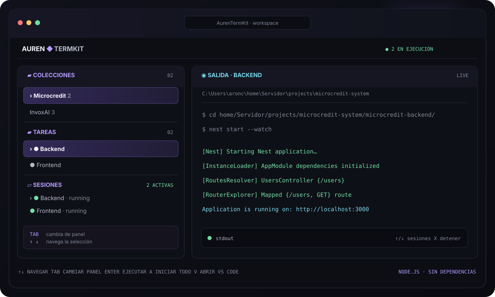

<div align="center">

# AurenTermKit

### Your development environment, ready from a single terminal.

Save commands by project, start your stack with one key, and follow every log in a clear TUI. No browser. No duplicate terminal windows. No third-party npm dependencies.


[](https://github.com/JhonattanAron/Auren_Terminal/stargazers)

[View README in Spanish](README.es.md)

<br>



<br>

[Quick start](#-quick-start) · [Controls](#-controls) · [Tasks](#-create-a-task) · [Configuration](#-configuration) · [Languages](#-languages)

</div>

---

## What is it?

AurenTermKit is a development workflow manager for your terminal. Group projects into **collections**, save their **tasks**, and run each command in order inside an integrated session.

Use it to start your frontend and backend, launch local services, or repeat any sequence of commands you usually type by hand.

### Built for real development workflows

- **Start with one key:** run a task or every task in a collection.
- **Logs where you need them:** view each process's output in the side panel.
- **Sessions under control:** stop an individual task, or close AurenTermKit to stop its child processes too.
- **Terminal first:** navigate with your keyboard; there is no need to switch to a web page.
- **Editable commands:** keep saved commands or replace them from the same interface.
- **Shell conveniences:** local autocomplete for paths and npm scripts, command history, and quick access to VS Code.
- **Local configuration:** your collections, folders, and commands stay on your machine.

## ✨ Quick start

### Requirements

- Node.js 18 or later.
- PowerShell or CMD on Windows; an interactive terminal on macOS/Linux.
- Optional: the Visual Studio Code `code` command in your `PATH` to open folders from AurenTermKit.

### Run it

**Install AurenTermKit from npm:**

```bash
npm i -g auren-termkit
aurentermkit
```

`npm i -g auren-termkit` installs the CLI globally. Then run `aurentermkit` from any terminal to open it.

**Run it from the repository:**

```bash
git clone https://github.com/JhonattanAron/Auren_Terminal.git
cd Auren_Terminal
npm start
```

You do not need to run `npm install` when using the repository: AurenTermKit uses modules built into Node.js.

On first launch, AurenTermKit opens with an empty configuration. Press `N` to create a collection, `Enter` to open it, then `N` to create a task and save your commands.

## ⌨️ Controls

`Tab` switches the active panel. `↑` and `↓` move the selection within the highlighted panel. The help text at the bottom of the TUI also changes to match the active panel.

<details open>
<summary><strong>Collections</strong></summary>

- `↑` / `↓` — select a collection.
- `←` / `→` — switch collections.
- `Enter` — open a collection and focus its tasks.
- `A` — start every task in the collection.
- `N` — create a collection.
- `E` — rename it.
- `D` — delete it, with confirmation.

</details>

<details>
<summary><strong>Tasks</strong></summary>

- `↑` / `↓` — select a task.
- `Enter` — run the selected task.
- `A` — start every task in the collection.
- `V` — open the folder where the task ends up in VS Code.
- `N` — save a new task.
- `E` — edit its name, description, or commands.
- `D` — delete it, with confirmation.

</details>

<details>
<summary><strong>Terminals and output</strong></summary>

- `↑` / `↓` — select a session; its logs appear in the right panel.
- `X` — stop the selected session and its child processes.
- `C` — clear finished sessions.
- Press `Ctrl+C` twice within 2.5 seconds — close AurenTermKit and stop all sessions.

</details>

At any prompt, type `exit` to cancel and return to the interface. `Q` and `Esc` do not close the application.

## 🧩 Create a task

1. In **Collections**, press `N` and enter a name, such as `Microcredit`.
2. Press `Enter` to open it; in **Tasks**, press `N`.
3. Enter a name, such as `Backend`.
4. Enter each command on its own line. Press `Enter` on an empty line, or type `save` and press `Enter`.

Example:

```text
cd home/Server/projects/microcredit-system/microcredit-backend/
nest start --watch
save
```

Commands run in order within the same process. The default starting folder is `C:\Users\<username>` on Windows and the home directory on macOS/Linux. A `cd` changes the working directory for subsequent commands.

`Tab` completes paths and npm scripts using Node.js logic; it does not depend on PowerShell or the Windows execution policy. Use `↑` / `↓` to browse command history in the editor.

When editing a task, answer `N` to “Replace the current commands?” to keep them. You can also answer `Y` and type `save` without adding lines: AurenTermKit keeps the existing commands and saves your other changes.

## 🖥️ One TUI for your whole stack

Sessions run in the background and send their output to the **Logs** panel. On Windows, AurenTermKit uses `cmd.exe`, so npm tools can find their `.cmd` executables without relying on PowerShell scripts. On macOS/Linux, it uses `$SHELL` or falls back to Bash.

When AurenTermKit closes, the manager stops the full process tree for each task (`taskkill /T` on Windows and the process group on macOS/Linux), so development servers are not left running.

## 🧭 Open a task in VS Code

Select a task and press `V`. AurenTermKit follows its `cd` commands, determines the final folder, and runs `code .` there. The VS Code `code` command must be available in your `PATH`.

## ⚙️ Configuration

The active configuration is created automatically and **is not committed to Git**: it may contain private paths, project names, and commands.

- Global installation: `~/.aurentermkit/collections.json` (under your user folder on Windows).
- Running from the repository: `data/collections.json`.
- Clean template: [`data/collections.example.json`](data/collections.example.json).

## 🌐 Languages

AurenTermKit starts in English by default. Press `L` in the interface and enter `es` to switch to Spanish or `en` to switch back to English. Your selection is saved in `collections.json` and remembered after restarting.

Example configuration:

```json
{
  "collections": [
    {
      "id": "microcredit",
      "name": "Microcredit",
      "description": "Local environment",
      "tasks": [
        {
          "id": "backend",
          "name": "Backend",
          "description": "Local API",
          "cwd": "C:\\Users\\aronc",
          "commands": [
            "cd home/Server/projects/microcredit-system/microcredit-backend/",
            "nest start --watch"
          ]
        }
      ]
    }
  ]
}
```

## 🌱 Contributing

Have an idea, found a bug, or want to add support for another shell? Open an [issue](https://github.com/JhonattanAron/Auren_Terminal/issues) or send a pull request. Please keep changes simple, cross-platform, and easy to use from the keyboard.

If AurenTermKit is useful to you, ⭐ **star the repo** to help more developers find it.

Want to get in touch with the creator? Follow me on [Instagram](https://www.instagram.com/jhonattan_aron/).

## License

This project is distributed under the [MIT License](LICENSE).
